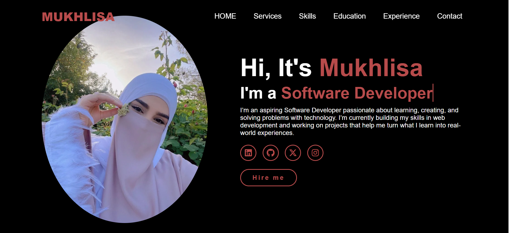

# Hi there! 👋 I'm Mukhlisa

### Aspiring Front-End Developer

Welcome to my GitHub profile!

I'm an aspiring Software Engineer with an interest in Front-End Development. I enjoy creating websites and improving my coding skills through practical projects.

## 🌱 About Me

- 💻 Currently learning HTML and CSS.
- 🚀 Building projects to improve my skills.
- 📚 Always willing to learn new things.
- 🎯 Working towards becoming a skilled Software Engineer.

## 🛠️ Languages and Tools

- HTML
- CSS
- GitHub
- Visual Studio Code

## 📂 My Projects

### Personal Portfolio Website

A personal website created using HTML and CSS.

### Akih Ayman Tribute Page

A tribute website created using HTML and CSS as part of my practice.

## 🌟 My Goals

- Improve my web development skills.
- Learn JavaScript.
- Build more projects.
- Become a Software Engineer.

## 📫 Connect With Me

- GitHub: https://github.com/isahmukhlisaabubakar-collab

---

⭐ Thanks for visiting my profile!
